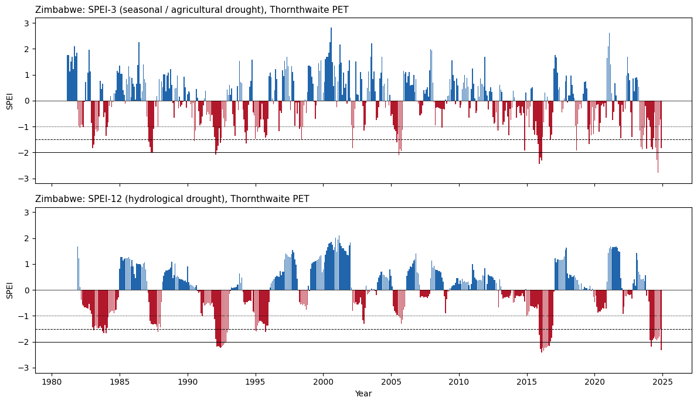
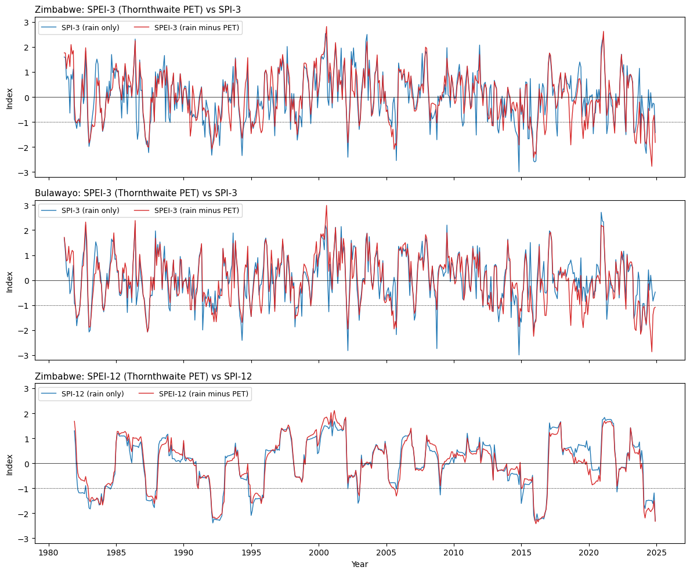
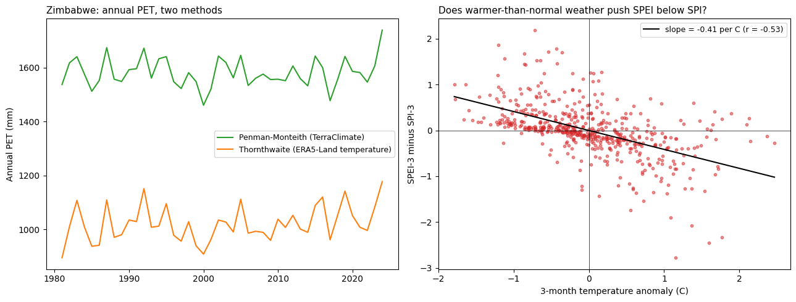
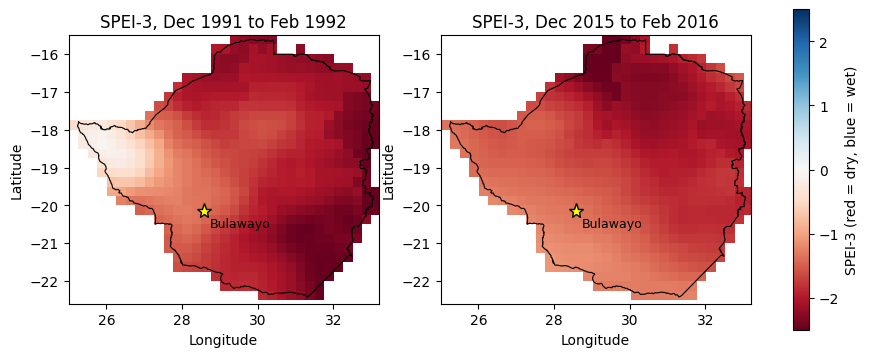

# SPEI Drought Analysis: Zimbabwe and Bulawayo (1981–2024)

**A 44-year assessment of meteorological drought, climatic water balance, and the relationship between temperature and drought severity in Zimbabwe, with Bulawayo as a local case study.**

This project calculates the **Standardized Precipitation Evapotranspiration Index (SPEI)** at 1-, 3-, 6-, and 12-month timescales, compares it with the precipitation-only **Standardized Precipitation Index (SPI)**, and examines the influence of potential evapotranspiration (PET). The analysis uses monthly climate data acquired through Google Earth Engine and produces time-series, statistical summaries, and spatial maps.

## Research questions

1. How has drought severity varied across Zimbabwe and the Bulawayo study area from 1981 through 2024?
2. How does accounting for potential evapotranspiration change drought assessments relative to SPI?
3. How are temperature anomalies associated with differences between SPEI and SPI?
4. How sensitive are the results to the choice of PET estimation method?

## Study area and data

| Component | Source / definition | Use |
| --- | --- | --- |
| Study period | January 1981 – December 2024 (528 months) | Monthly climate observations |
| Zimbabwe | National boundary from `USDOS/LSIB_SIMPLE/2017` | National spatial averages and mapped drought |
| Bulawayo | 10 km radius around 28.58° E, 20.15° S | Local case study; **not** the municipal administrative boundary |
| Precipitation | TerraClimate `pr` | Monthly precipitation (mm) |
| Reference PET | TerraClimate `pet` | Penman–Monteith-based comparison (mm) |
| Air temperature | ERA5-Land Monthly Aggregated `temperature_2m` | Temperature input for Thornthwaite PET (°C) |
| Primary PET calculation | Thornthwaite method, implemented in Python | Temperature-based PET estimate (mm) |
| Drought timescales | 1, 3, 6, and 12 months | Short- to longer-duration anomalies |

**Dataset catalogs:** [TerraClimate](https://developers.google.com/earth-engine/datasets/catalog/IDAHO_EPSCOR_TERRACLIMATE) · [ERA5-Land Monthly Aggregated](https://developers.google.com/earth-engine/datasets/catalog/ECMWF_ERA5_LAND_MONTHLY_AGGR) · [LSIB boundaries](https://developers.google.com/earth-engine/datasets/catalog/USDOS_LSIB_SIMPLE_2017)

The notebook computes spatial mean climate series for each region using Google Earth Engine. The mapped analysis uses an approximately **0.25° grid** and TerraClimate PET rather than the point/region-level Thornthwaite calculation.

## Methodology

1. **Extract and align monthly data** for each study area from TerraClimate and ERA5-Land.
2. **Estimate Thornthwaite PET** from monthly temperature using a latitude/day-length adjustment; retain TerraClimate Penman–Monteith PET for a sensitivity comparison.
3. **Calculate monthly climatic water balance:** `D = precipitation − PET`.
4. **Aggregate** precipitation and water balance into rolling 1-, 3-, 6-, and 12-month totals.
5. **Standardize per calendar month:** fit a three-parameter log-logistic distribution to accumulated water balance for SPEI; fit a gamma distribution (with zero-precipitation adjustment) to precipitation for SPI. Convert cumulative probabilities to standard-normal scores.
6. **Assess historical drought:** compare SPEI and SPI time series, drought frequencies, annual temperature/PET trends, and selected drought years.
7. **Investigate temperature relationships:** regress `(SPEI-3 − SPI-3)` against the three-month temperature anomaly.
8. **Map selected drought seasons:** create SPEI-3 maps for December–February ending in 1992 and 2016 using gridded TerraClimate water balance.

The notebook uses a normal-distribution fallback where a log-logistic fit is invalid and clips standardized scores to ±3. These decisions may affect tail-event estimates and should be considered when interpreting extreme drought values.

## Key results

### 1. Climate and drought conditions

Across 1981–2024, the notebook reports **636 mm** average annual rainfall for Zimbabwe and **572 mm** for the Bulawayo study area. Its Thornthwaite PET estimates average **1,021 mm/year** nationally and **891 mm/year** for Bulawayo; TerraClimate's PET estimates are higher (**1,581** and **1,607 mm/year**, respectively). PET methods are therefore not numerically interchangeable.

The most severe **SPEI-12 (Thornthwaite)** months identified in the saved results were:

| Study area | Month | SPEI-12 | Interpretation |
| --- | --- | ---: | --- |
| Zimbabwe | February 2016 | **−2.43** | Extreme drought |
| Zimbabwe | December 2024 | **−2.33** | Extreme drought |
| Bulawayo | March 2024 | **−2.39** | Extreme drought |

At the national scale, the saved results also identify severe conditions during **1992** (minimum SPEI-12 = **−2.22** for that year). At the Bulawayo study location, **2024** stands out strongly, while the minimum 2016 SPEI-12 was **−1.65**. These differences illustrate why a national average and a local case study should be reported separately.



*Figure 1. Zimbabwe drought variability at seasonal (3-month) and longer (12-month) timescales, using Thornthwaite-based SPEI.*

### 2. SPEI versus SPI: evaporative demand changes the assessment, but not uniformly

Over the **517 valid months** in the 12-month analysis, the proportion below the drought threshold (`index < −1`) was:

| Study area | SPI-12 | SPEI-12: Thornthwaite | SPEI-12: Penman–Monteith |
| --- | ---: | ---: | ---: |
| Zimbabwe | 94 months (18%) | 82 months (16%) | 90 months (17%) |
| Bulawayo | 69 months (13%) | 86 months (17%) | 84 months (16%) |

SPEI and SPI sometimes disagree about drought severity, and the direction varies by place, event, and PET method. For **SPI-3-defined dry months** (`SPI-3 < −1`), the *average* difference `SPEI-3 − SPI-3` was **+0.35** nationally and **+0.23** for Bulawayo using Thornthwaite PET (the Penman–Monteith differences were **+0.24** and **+0.20**). Therefore, the notebook **does not establish that SPEI is always more negative than SPI during dry months**.



*Figure 2. SPI and Thornthwaite-based SPEI at three- and twelve-month timescales.*

### 3. Temperature and PET: association rather than proof of causation

| Annual trend, 1981–2024 | Zimbabwe | Bulawayo |
| --- | ---: | ---: |
| Air temperature | **+0.13 °C/decade** (`p = 0.054`) | **+0.12 °C/decade** (`p = 0.114`) |
| Thornthwaite PET | **+15.09 mm/decade** (`p ≈ 0.050`) | **+11.29 mm/decade** (`p = 0.120`) |
| Penman–Monteith PET | **+1.91 mm/decade** (`p = 0.770`) | **−0.96 mm/decade** (`p = 0.893`) |

The regression of `SPEI-3 − SPI-3` on the three-month temperature anomaly produced:

| PET approach | Zimbabwe: slope (index units/°C), r | Bulawayo: slope (index units/°C), r |
| --- | --- | --- |
| Thornthwaite | **−0.41**, `r = −0.53` | **−0.35**, `r = −0.61` |
| Penman–Monteith | **−0.20**, `r = −0.33` | **−0.16**, `r = −0.34` |

All four regressions were printed in the notebook with `p = 0.000` (rounded to three decimal places, meaning **p < 0.001**, not a probability of exactly zero). The negative slopes indicate that *warmer-than-usual months tended to correspond to relatively lower SPEI than SPI*.

**Important qualification:** Because the SPEI calculation itself includes temperature-derived evaporative demand, this relationship is partly built into the index construction. The regressions are associative, not independent causal evidence that warming caused specific historical droughts. The annual temperature trends are not significant at the conventional `p < 0.05` threshold for either study area; the Thornthwaite PET trend in Zimbabwe is borderline at the reported precision.



*Figure 3. National annual PET estimates and the association between temperature anomalies and SPEI-minus-SPI.*

### 4. Recent periods and the Bulawayo case study

The share of months classified as dry using **3-month indices (`< −1`)** was, in 2011–2024:

| Study area | SPI-3 | SPEI-3: Thornthwaite | SPEI-3: Penman–Monteith |
| --- | ---: | ---: | ---: |
| Zimbabwe | 20% | 21% | 21% |
| Bulawayo | 12% | **27%** | **24%** |

This comparison is particularly revealing for Bulawayo: a rainfall-only metric flagged considerably fewer dry months than either SPEI approach in this period. However, the percentages alone do not establish a statistically significant long-term trend, and the time periods used for the notebook's comparisons have different lengths (2011–2024 is 14 years).

### 5. Spatial patterns in historic drought seasons

The **December 1991–February 1992** and **December 2015–February 2016** gridded SPEI-3 maps show widespread negative anomalies across much of Zimbabwe, with variation across regions. The maps illustrate within-country heterogeneity that is lost in the national mean time series.



*Figure 4. Spatial SPEI-3 for two historical December–February drought seasons, derived from gridded TerraClimate water balance using Penman–Monteith PET.*

## Interpretation and conclusion

The analysis identifies notable **drought episodes** in the 1981–2024 historical record, including widespread national drought in the early 1990s and 2015/16 and an especially severe **2024 event at the Bulawayo study location**. SPEI and SPI provide related but nonidentical descriptions of drought because SPEI additionally incorporates evaporative demand. The negative temperature-anomaly relationships are consistent with **hotter-than-usual conditions increasing drought severity relative to a rainfall-only index**, but this effect is not uniform across all events and cannot, by itself, support a causal attribution claim.

**Main takeaway:** Evaluating both precipitation and atmospheric water demand provides a more complete drought-monitoring perspective than rainfall alone, while regional differences and PET-method sensitivity must remain explicit.

## Figures and outputs

The notebook generates:

- `fig1_spei_timeseries_zimbabwe.png` — Zimbabwe SPEI-3 and SPEI-12 historical series.
- `fig2_spei_vs_spi.png` — SPI/SPEI comparisons for Zimbabwe and Bulawayo.
- `fig3_temperature_effect.png` — PET series and temperature-anomaly relationship.
- `fig4_spei3_maps.png` — 1992 and 2016 spatial SPEI-3 maps.
- `spei_zimbabwe_monthly.csv` and `spei_bulawayo_monthly.csv` — monthly temperature, precipitation, PET, water balance and drought indices.
- `spei_outputs.zip` — archive produced when the notebook is run.

The figures under [`figures/`](figures/) are exported from the notebook's **existing saved outputs**. CSV files are **generated on execution** and are not included in this repository bundle.

## Repository structure

```text
SPEI_Zimbabwe_Bulawayo/
├── README.md
├── requirements.txt
├── SPEI_Zimbabwe_Bulawayo_1981_2024.ipynb
└── figures/
    ├── fig1_spei_timeseries_zimbabwe.png
    ├── fig2_spei_vs_spi.png
    ├── fig3_temperature_effect.png
    └── fig4_spei3_maps.png
```

## How to reproduce

**Requirements:** Python 3.10+ recommended, Jupyter or Google Colab, an active [Google Earth Engine account](https://earthengine.google.com/), and a Google Cloud project enabled for Earth Engine. Internet connectivity and Earth Engine access are required to retrieve the climate inputs. The notebook was developed with a Colab-style workflow; package versions have not been independently locked or verified in a clean environment.

1. Download or clone the repository, then install the dependencies:

   ```bash
   python -m pip install -r requirements.txt
   ```

2. Launch Jupyter (`jupyter lab`) or open `SPEI_Zimbabwe_Bulawayo_1981_2024.ipynb` in Google Colab.
3. In the Google Earth Engine authentication cell, replace `YOUR_GEE_PROJECT_ID` with your own Google Cloud project ID. Sign in when prompted.
4. Run cells **in order**. Data extraction uses Earth Engine API requests and may take time.
5. Inspect figures and printed results; output CSV/PNG files are saved to the current notebook working directory.

**Note:** The notebook contains `!pip install -q geemap` for Colab convenience. When using the provided `requirements.txt`, that installation cell is redundant and may be skipped.

## Limitations and future improvements

- **Sensitivity to PET model:** Thornthwaite relies primarily on temperature, whereas Penman–Monteith includes other climatic factors. They produce different absolute PET estimates and drought classifications.
- **Spatial representation:** Zimbabwe values are spatial averages; the Bulawayo result represents a **10 km circular buffer**, not the city's administrative area. A single latitude approximation is used for national Thornthwaite PET.
- **Statistical modelling:** The fitted distributions use the same 1981–2024 observations for calibration and descriptive evaluation. A normal fallback and ±3 clipping may affect tail results.
- **Trend inference:** Simple ordinary least-squares regressions do not explicitly account for temporal autocorrelation or other sources of uncertainty. The temperature-related relationships are **not causal attribution**.
- **Map resolution:** The 0.25° maps are too coarse for neighborhood-scale interpretations and use the Penman–Monteith PET pathway rather than gridded Thornthwaite PET.
- **Reproducibility:** Online dataset access and Earth Engine authentication are required; the analysis has not been independently rerun in a clean environment for this publication.

Potential next steps include trend tests that account for autocorrelation, sensitivity checks with alternative distributions and reference periods, gridded Thornthwaite PET maps, and comparison with observed local drought impacts.

## Tools

Python · Google Earth Engine (`earthengine-api`) · geemap · pandas · NumPy · SciPy · Matplotlib · Jupyter

## Project context

Developed as an academic drought-monitoring analysis applying statistical methods and environmental data to conditions in Zimbabwe, with Bulawayo used as a focused case study.
